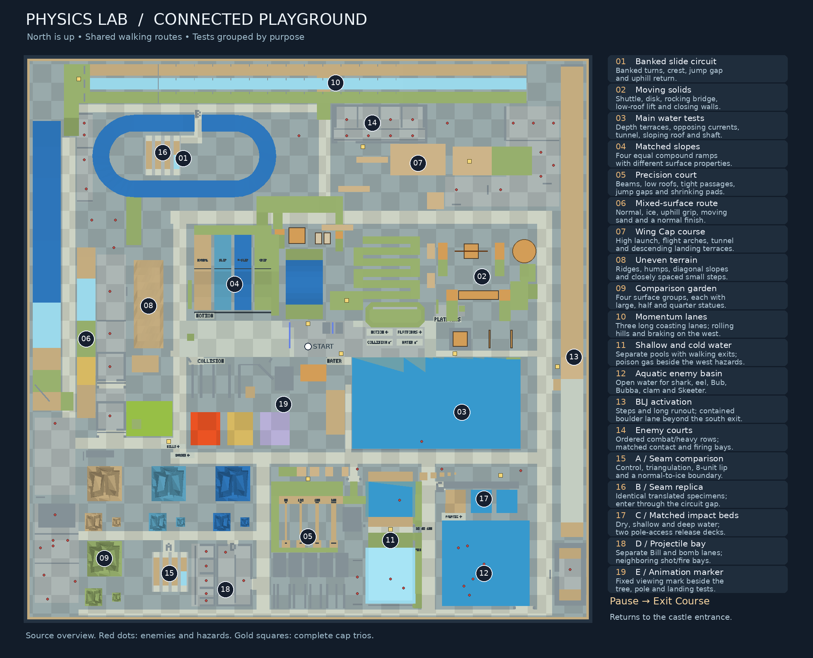
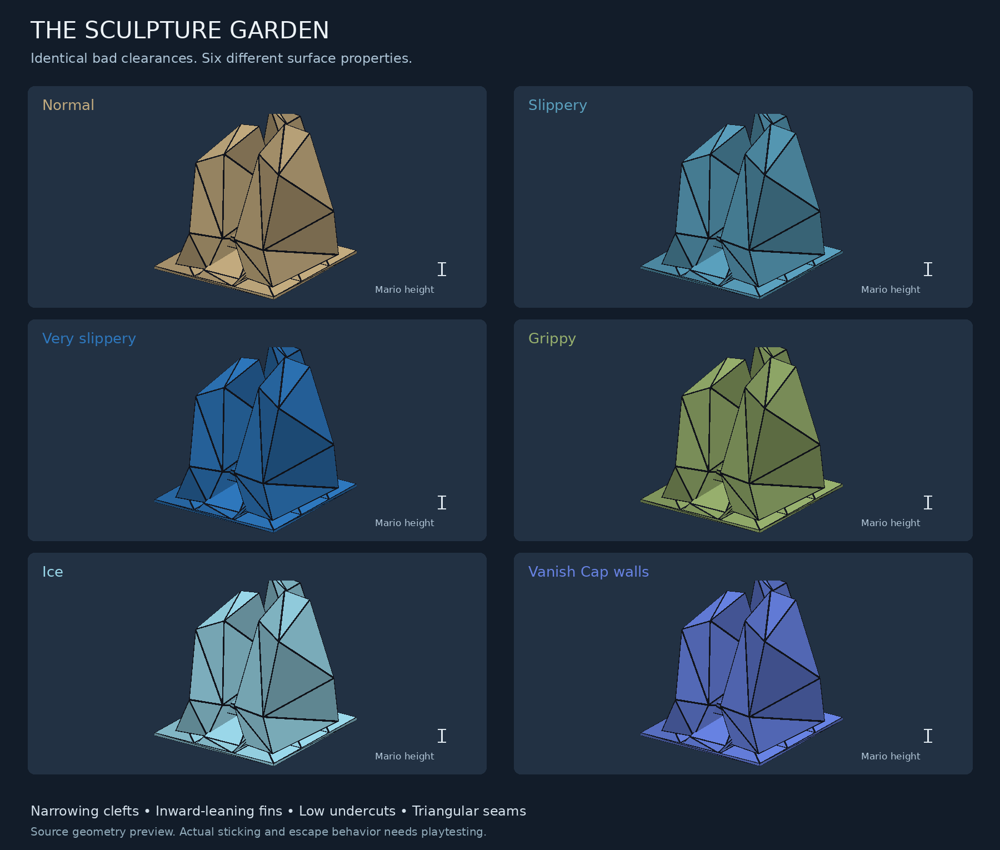
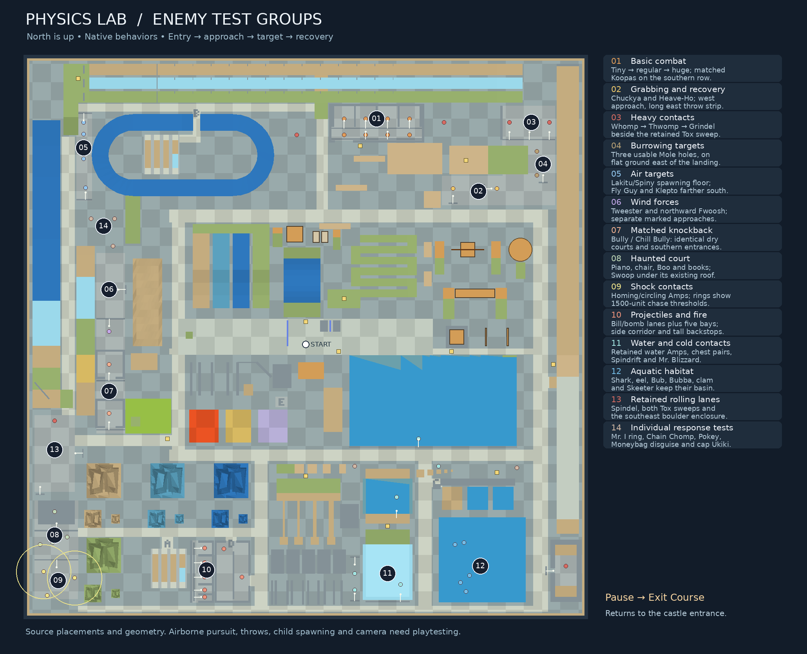

# Physics Lab

A single open area for movement, collision, surface and power-up experiments.
It occupies former unused level slot 32, named **PHYSICS LAB** in both existing
level selectors. The debug boot target is set to this level, act 1. Non-boss
enemies use courts grouped by test purpose. Four connected districts surround
the open central commons; no stars, reset controls or additional HUD are part
of the map.

A wooden sign hides 60 units from both walls of the underwater shaft's rear
corner, facing diagonally inward so the reading camera stays inside the shaft.
The sign and its reading prompt appear only within 125 units of Mario, including
exactly 125. It reads "You really checked down here?" and follows the shared
underwater sign rule: stand on the floor with Metal or Vanish power to read it.

Background music is **Mii Channel — Wii**, converted to SM64 by TheNail from
a MIDI by iteachvader on haminet.com. It uses the Inside Castle sound bank
(decimal 14, hexadecimal `0E`) in its own sequence slot, `0x23`. The supplied
[source sequence](../../sound/custom/mii-channel/Mii-Channel_sb14.m64) and
[original README](../../sound/custom/mii-channel/README.original.txt) are preserved
unchanged; the README permits ROMhack use and makes credit optional. The
[expanded README](../../sound/custom/mii-channel/README.txt) includes the creator's
showcase, channel, original download folder and MIDI attribution. The active
copy is `sound/sequences/23_custom_mii_channel.m64`.

The playground has one rectangular outer boundary, X/Z=-15200 through 15200,
with the main floor at Y=0. North is negative Z. A continuous ground-level
promenade joins the original test core, the movement strips, and the southern
comparison courts. The former internal perimeter curbs have been removed.
Ground checks follow one world-aligned 1000-unit grid; special walkable surfaces
use the same colors throughout the map. Existing courses and their numeric IDs
are preserved.

The scale grid stays on the flat ground and walking routes. Raised fixtures use
solid finishes, with neutral gray walls/courts, tan ordinary tests, amber movers,
and consistent colors for friction, hazards and underwater current lanes. Court
paint follows the inside of its walls. Soft overhead shading keeps rotated
statues consistent with the vertical object shadows. The opaque ice lanes, rims
and sculptures receive decal shadows; water retains transparent-surface shadows.
Cap and shell boxes have flat ground under their full shadow footprint.



## Layout

| Location | Contents |
| --- | --- |
| Center | Flat east/west runway; Wing, Metal and Vanish Cap boxes; grounded and elevated Vanish barriers. |
| Northwest | Four equal compound ramps (about 15, 30 and 45 degrees) with default, slippery, very slippery and nonslippery collision. Shared rear landing at Y=1292. |
| North center | Faceted slippery bowl with nonslippery approaches; tilting platform; paired checkerboard platforms that rise, fall and rotate. |
| Northeast | Six nonslippery switchback ramps reaching a Y=3000 drop/flight deck, with a complete cap trio; lower landing shelves. |
| Southwest | Wall-kick alleys with 350, 550 and 750 units of clear space; 32-unit wall; square/angled corners; slope into a wall; 140-unit crawl clearance. |
| South center | Hangable ceiling at Y=330; trees; 1200/2000-unit poles; steps and elevated gaps of 200, 350 and 500 units. |
| Southwest of the hub | Separate lava, shallow quicksand and eastward-wind patches. |
| Southeast | Water at Y=-40, shallow shoreline, progressively deeper slopes down to Y=-1800, an east-side current lane, submerged tunnel and thin wall, and underwater steps. |
| West end of runway | Open cannon in a recessed approach, facing east. |

## Testing districts

The original core retains its test dimensions. Related tests share approaches
and return routes, with longer courses around the outside:

| Section | Location and contents |
| --- | --- |
| Banked slide circuit | Far northwest: 900-unit-wide loop with a downhill straight, two banked turns, crest, 400-unit jump gap and uphill return. A nonslippery ramp reaches the start; a Shell box sits nearby. Ground below catches missed jumps. |
| Moving solids | Far east/northeast: horizontal shuttle with docks, rotating disk, rocking bridge, lift under a low roof, and two closing walls. All sit above ordinary ground. |
| Water obstacle course | Connected east basin: alternating walls, a sloping submerged ceiling, an open-top shaft with a lower side entrance, and separate +Z/-Z current lanes. Metal Cap, Shell box and underwater shell nearby. |
| Shallow-water terraces | North edge of the new basin: flat water depths of 20, 60, 100, 200 and 400 units. A continuous nonslippery ramp along the east bank climbs from the deep floor to dry ground. |
| Precision geometry | South center: beams 80/120/180/260 units wide, shrinking jump pads, overhang, roof clearances of 100/125/150/175/200, and passages 100/140/180/240/320 wide. |
| Mixed-surface route | West, beside the rolling hills: normal ground, actual ice, nonslippery uphill ramp, shallow moving quicksand and normal downhill finish. |
| Wing Cap course | North of the existing launch tower: three elevated arches, descending tunnel with 900-unit headroom, and landing terraces. A complete cap trio is on the final landing. |
| Uneven terrain | West, between the mixed-surface strip and central promenade: triangular ridges, humps, oblique slopes, and closely spaced steps rising in 30-unit increments. |
| Sculpture garden | Southwest comparison garden: four matching jagged sculptures, with inward-leaning fins, a narrowing rear cleft, an angled side spike, intersecting faces and a low central undercut. Normal, slippery, very slippery and nonslippery surfaces; complete cap trio nearby. |
| Smaller sculptures | Each of the four surface groups has its full-size, half-size and quarter-size specimens together, with open walking space around them. Both smaller versions face 180 degrees opposite the full-size statues, with matching rotated collision. Heights are 975 and approximately 488 units. |
| Momentum comparison lanes | Far north: three 600-wide lanes with identical downhill starts, 13,400-unit flat sections and opposing uphill finishes. Normal, ice and nonslippery surfaces make coasting and braking comparable. |
| Rolling hills and braking | New far-west strip: repeated valleys/crests, then ice → normal → nonslippery ground, with an oblique wall for glancing slide contacts. |
| Poison gas | West hazard group, green patch at X=-9900–-7400, Z=3400–5300. Native poison-gas volume at Y=550, floor at Y=20, and raised refuges/ramp reaching Y=600. Metal Cap supplies are nearby. |
| Separate shallow pool | South water court, X=3300–5700, Z=7800–9700: water at Y=180, with 20/60/100-unit depth terraces and sloped approaches. Compare standing, crouching, crawling, sliding and water-surface bounces. |
| Cold pool | South water court, X=3300–5700, Z=11400–14300: water at Y=600, 480-unit deep floor and icy rim. Uses the existing snow-course drain inside this pool only, including at the swimming surface. Other water remains ordinary. |
| Aquatic habitat | Open southeast basin, X=7300–12100, Z=9900–14600: deep water for shark, eel, Bub, Bubba, clam and Skeeter. All four underwater banks face inward and meet the continuous Y=-2200 floor, enclosing the swimming space above the death plane. The east walking ramp exits at the south shore. Shark retains its native 1700-unit orbit; the local eel path moved with the tank. No courses cover this basin. |
| BLJ activation | Eastern movement strip, X=13800–15000. Orange starting pad near Z=1000–2200, followed northward by 20 steps with 64-unit rises and 128-unit treads. A 13,340-unit elevated runout continues north from the top. Walk directly from the eastern promenade near Z=2500; face south, away from the steps, and travel backward up them. Current movement rules are unchanged; activation needs playtesting. |

## Shared terraces and return routes

The [district redesign](../../llm/docs/physics-lab-redesign-2026-10-07/proposal.md)
is implemented in the terrain generator. A broad flat forecourt connects the
starting area, water edge and a chamfered stopping terrace beside the launch
tower. The terrace occupies X=3150–6350, Z=-2000–-650 and rises continuously
from ground to Y=120. Its inset rear curb rises only 120 units above the
back edge. Four flush directory panels lie on the forecourt before the terrace.
The former isolated
water-side pad, tall post and crown are removed. The original runway stays flat and open; the
MOTION, PLATFORMS, COLLISION and WATER entrance panels face the commons.
The ground promenade remains the dependable route between every test, with
direct raised connections for repeated practice:

| District | Added route |
| --- | --- |
| Motion yard | An uphill shoulder introduces the matched slopes. The northern terrace is 900 units deep, at Z=-7800–-6900, X=-2800–1900. Its Y=800/600 floors retain the slope, tilter and checkerboard branches. A Y=1292 side landing at X=-2000–-1600 joins the slope landing; its front ramp descends directly to ground at Z=-1300 beside the commons. |
| Platform workshop | Two offset landing forms flank an open forecourt toward the shuttle approaches. A thin Y=350 gallery east of the rocking bridge, X=11050–12000, Z=-3150–-1600, meets its original dock directly. A side link connects the disk approach; an eastern ramp reaches ground at X=12500. |
| Collision garden | Angled side walls introduce the collision entrance. The Y=250 gallery joins all four beam finishing pads at Z=11400–11650. A 400-unit-wide western return at X=-2000–-1600 reaches their start deck without descending. Its north ramp reaches ground at Z=7800. |
| Water court | A Y=240 crossing at Z=8600–9000 joins the beam start deck to the shallow pool's western rim, with an independent ground ramp at X=2300–2700. The two existing dry quays, shallow/cold pool approaches, flat supply crossing and eastern ground promenade remain. |

The northern slabs have closed, neutral gray undersides. Columns stay outside
the ground routes and platform travel, and those routes retain at least 400
units of headroom. The front landing leaves the tilter's original approach
usable below it. The platform gallery is 80 units thick, supported by four
columns. Its disk link runs beside the original ramp and crosses only above
the low end, leaving over 200 units of standing clearance there. The platform
entrance has no overhead span, and its raised marker stays outside the original
bridge approach and moving sweep. The beam return and water crossing stay clear
of the independent roof, passage and hanging-ceiling specimens.

The launch tower is open beneath its raised switchbacks and Y=3000 deck.
Five ramps and all five turn landings use 100-unit-thick slabs; the launch
deck is 160 units thick. Columns sit at the outer landing edges and deck
corners. Every original top triangle, ramp profile and landing height remains
exact. The first ramp and separate lower drop shelves keep their solid forms.
The lift roof has four 120-unit corner posts in place of its western wall.
They clear the full 800-unit platform footprint and vertical travel, opening
its west ground approach. The roof retains its Y=950 underside, Y=1120 top
and 130-unit clearance at the lift's high stop.

The forecourt directory uses four separate floor panels: motion/platforms in
the north pair, collision/water in the south pair. Thirty-unit lettering cells
replace the old seventeen-unit curb lettering, with a ninety-unit gap before
each arrow. Their neutral solid backing replaces the corresponding ground
pixels without overlapping them or changing collision. Read facing north,
the arrows point west, east, southwest and southwest respectively. The curb
keeps its original low dimensions and no longer carries text.

GARDEN and HILLS panels identify the western ground branches. The garden
approach bends around the slippery sculpture's plinth; the hill route follows
the existing western link. AQUATIC points east along the basin's northern
shore. Neutral entrance aprons and ten 120-unit corner markers frame both
western Bully forecourts, the shallow pool's west entry, the cold pool's north
entry and the aquatic basin's south walking exit. The two Bully reference
lines and matched 600-unit openings remain; posts leave the original ramps,
supply crossing and promenade open.

One broad stepped landmark sits south of the western link at X=-12100–-10600,
Z=6100–6460. Five 300-unit-wide sections rise 120/240/360/240/120 units, giving
the two Bully courts one shared silhouette. The walking link at Z=5400–6000,
both court interiors and their entrance/recovery markings retain their geometry.

Three chamfered shoulders sit on the inward side of the dry quays, in the gaps
beyond the pool rims at X=5710–5850. They taper from Y=160 to 0 at Z=9750–10100,
from 0 to 240 at Z=10600–11000, and from 160 to 0 at Z=14450–14700. Their green
nonslippery tops remain below the adjacent quay profiles; gray sides close
each solid. The original 350-unit-wide quay ramps, ground promenade, supply
crossing, pool rims and water volumes remain exact. The shallow shoulder ends
before the existing cold-pool entrance marker.

A native 3200-unit climb pole at X=1020, Z=-2100 stands 180 units west of
the Y=3000 launch deck, clear of its
columns and underside. Its own visible pole matches its interaction height;
the original six-ramp route and existing pole specimens remain.

Practice paint uses one start bar and two finish bars. The slope starts lie
on their Y=1292 flat staging strips, with a shared ground finish after all four
toes. The beam marks lie on their Y=250 entry deck and finishing pads, aligned to
each beam's width. The measured slope profiles and beam spans remain clear.
All marks are render-only and retain the original collision and friction.

Raised connecting floors use the existing nonslippery green finish, with
neutral gray sides. The world-aligned ground grid continues through the
existing district entrance paint and new aprons, and around the solid directory
and junction placards. Flush labels identify the four slope surfaces, beam widths
80/120/180/260, shallow depths 20/60/100 and cold depth 480. All label paint
partitions the rendered floor without replacing its original collision.
Existing specimens, supplies, enemy placements, motion timing, water volumes
and level routing remain unchanged.

The open-structure pass replaces 114 support and directory collision triangles
from the preceding layout, retaining its other 10,670 triangles exactly and
adding 304 new support/slab triangles. The shared terraces and return loops
remain unchanged. For that pass, the generator check and 76 focused host
checks passed, and the GCC 16.2 US/N64 play ROM built successfully. Nine
scripted walking checks used the normal camera through all six tower ramps,
the new ground passages, lift approaches and terrace route. Their captured
checkpoints use the game's camera; separate fixed views show the three
structural changes:


The preceding open-structure
[verification record](../../llm/docs/physics-lab-redesign-2026-10-07/open-structures-pass/validation.json)
identifies the tested ROM/ELF, scripted controller routes and inspected views,
including two interrupted capture attempts and their completed checkpoints.
The [previous commons pass](../../llm/docs/physics-lab-redesign-2026-10-07/commons-pass/validation.json)
retains its ten walking checks for the terrace, district entrances and original
bridge/water approaches, before the structural supports were opened.
The [previous connection pass](../../llm/docs/physics-lab-redesign-2026-10-07/composition-pass/validation.json)
retains its 22-route verification, including the original disk and tilter
approaches, before the commons and entrances were reshaped.
The [first-pass record](../../llm/docs/physics-lab-redesign-2026-10-07/implementation-validation.json)
is retained for its earlier layout. Scripted navigation and fixed-camera views
remain separate from manual camera/feel testing and hardware or comparative
performance measurement.

The preceding [wayfinding pass](../../llm/docs/physics-lab-redesign-2026-10-07/wayfinding-pass/validation.json)
records source/host verification for the arrows, pole and practice paint.
It preserves the entire terrain collision file. That pass had no ROM
rebuild or new emulator playtest; the game views above show the preceding
open-structure build. Its separate source preview records that pass's additions.

The preceding [entrance polish record](../../llm/docs/physics-lab-redesign-2026-10-07/entrance-polish-pass/validation.json)
covers the larger directory, outer directions and entrance markers. It records
preservation of every preceding collision triangle, with additions confined
to the ten low markers. This remains source/host verification without a new
ROM build or emulator playtest.


The current [landmark record](../../llm/docs/physics-lab-redesign-2026-10-07/landmark-pass/validation.json)
covers the shared combat landmark and chamfered quay shoulders, including
preservation of preceding collision and clear walking routes. This small pass
has source/host verification without a new ROM build or emulator playtest.


## Empirical fixtures

The layout proposal's first phase is implemented. Existing courses, sculptures,
water tests and movers retain their positions and measured dimensions. Flush
walking links and neutral A–E floor letters identify the new bays:

| Bay | Fixture and use |
| --- | --- |
| A | Southwest seam comparison, X=-8500–-6550, Z=11650–13800. Four 300-unit lanes, each with a 300-unit start, 1500-unit specimen and 350-unit recovery: smooth control, coplanar irregular triangulation, an exact 8-unit lip, and normal → ice. |
| B | An exact translated replica of A inside the slide circuit, X=-8900–-6950, Z=-11100–-8950. Walk in through the existing 400-unit jump gap; the circuit is unchanged. |
| C | Matched impact beds at Z=8250–9500: dry ground at Y=0, shallow water with floor Y=-60, and deep water with floor Y=-600. Both water surfaces are Y=0, with walking exits at their southeast corners. Release decks at Y=1700 and 3600 share the north edge. Climb the 3800-unit pole at (7150, 8600), turn to face north, then jump onto a boarding arm. A complete cap trio sits north of the bay. |
| D | Projectile comparison at X=-5000–-3050, Z=11200–14600. Bullet Bill faces south down the western lane; the unchanged water-bomb spawner occupies the eastern lane. 350-unit walls separate the tests, with a north entrance and east return. Fast movement can send native water-bomb predictions outside the bay; the walls do not establish universal containment. |
| E | A fixed ground observation mark at X=-1650–-1000, Z=3300–3850, beside the original tree/pole, landing and step tests. |

The northern momentum lanes have common release marks on their start deck,
a transverse ramp-exit mark, and 1000-unit stopping-distance ticks. These marks
change rendering only; the original collision triangles and friction remain.
The two deck heights permit comparisons around the existing small/large fall
damage ranges. Shallow contact occurs 60 units below the dry floor, so an actual
velocity/contact readout must account for that difference.

These are physical fixtures and wayfinding. Native-family resets, calibrated
speed controls, result capture, frame stepping and measurement readouts remain
the proposal's later instrumentation phase. Pole boarding, drop alignment,
projectile trials and camera behavior still require an emulator playtest.



The sculptures intentionally invite wedging, awkward landings and failed
standing transitions. Their central undercut has about 151 units of clearance
at its midpoint. Contrasting facet shades make the faces readable without extra
outline geometry. Each remaining sculpture retains its original 126 collision
triangles but renders 92 nearby and 50 at distance. The ice and Vanish Cap
sets, including their half/quarter copies, have been removed. The reference
image above shows the original six materials; four remain. All 12 specimens form a
single static scenery batch, without individual objects or behavior updates.
One common translation/quarter-scale basis keeps exact fractional positions in
signed 16-bit vertices, including the rotated half/quarter copies. Their static
collision stays loaded. Whether a particular approach actually traps Mario
must be established by playtesting.

Terrain submits one ground pass and six prebuilt structure runs in the original
order. Nearby and distant structure runs use consecutive groups with padded
RSP bounds, at most 256 triangles and an 8,192-unit X/Z span. The 24-entry vertex
cache, primitive order and existing LOD choices are preserved. Checker rectangles
can merge across former list boundaries without changing their world pattern
or collision. There is no terrain hierarchy, per-section CPU frustum test,
wall-volume ranking or animated actor/shadow envelope. Near/distant selection
still checks only the three authored LOD fixture bounds.

Alternate northern commands share the complete meshes' vertices and bounds.
The small northern edge faces stay in every list; only +Z planes at/after the
interior Z=-12,000 cut can be omitted. One camera classification selects this
stream when the eye is north of every omitted plane by a conservative margin.
A high camera in the central strip also omits proven downward/outward backfaces.
Full-list fallbacks remain for stale/invalid/scaled/reflected cameras,
unexpected model transforms, compatibility contexts and allocation failure.

The checker floor uses normal clipping by default before vertex transformation.
Its merged patches can cross the camera plane in close views and leave holes
with a wider guard. The validated aerial stream may select a two-times floor
guard only when the complete geometry-derived floor bounds lie more than 4,096
world units in front of the camera plane, with a finite depth at most 65,536.
This alternate shares the original floor sections and restores the configured
baseline; all existing fallbacks retain normal floor clipping.
The shared structure/sculpture material keeps a two-times clipping guard,
restoring the configured baseline afterward. Groups containing a single face
larger than the 8,192-unit X/Z limit use normal clipping before their vertices
are transformed; wider clipping can warp the long boundary walls near the camera
plane. The parent restores the two-times guard after each child so early culling
cannot leak the override. Geometry and collision remain unchanged.
Twenty complete label footprints
use small opaque, point-sampled textures derived from the existing block font.
Their positions, dimensions, palette and checker phase are retained; incomplete
footprints keep their geometry. Each label reuses its four enclosing vertices
for culling before texture loading, with material restoration outside the child.
Clipping and textured letters have small edge-rounding/antialiasing differences.
The native RSP measurements and preservation checks are recorded in the
[optimization report](../../../../physics-lab-rsp-2026-10-07/RESULTS.md).

All 12 statues submit through one small command list, sharing material state
and one transform. Each retains its prebuilt near/distant mesh and RSP bounding
box. There is no CPU statue frustum or through-wall rejection. Water retains
its transparent layer. Removing CPU rejection can increase RSP work in some
views; this rollback does not establish an emulator performance improvement.

The checker floor uses disjoint rectangular patches and one 32×32 I8 texture
(1 KiB), with world-aligned 1,000-unit squares and unchanged pool openings.
Point sampling preserves the boundaries; ground draws first and restores
untextured shading and bilinear filtering. The dark tint differs by at most
one 8-bit color step.

Hidden-face cleanup removes whole rectangles buried in authored opaque boxes.
Pool holes, floating open boxes, Vanish fixtures and partly covered faces remain.
Render-only merging joins compatible consecutive rectangles and additional pairs
across nonintersecting intervening draws. Surface settings, winding and original
collision remain unchanged. Bounded groups add vertex uploads when retained
and skip their geometry when outside the RSP view.

Statues use 92 triangles nearby and 50 at distance, down from 126 and 74.
The plinth top is one plain rectangle instead of nine tiled rectangles.
Generation removes 18 fully buried faces nearby and eight at distance using
conservative solid cores; no camera-dependent CPU checks are added. Original
indices preserve the surviving nearby facet colors. Near vertex uploads remain
275–277 per statue. Distant meshes share similar incident facet colors at common corners, with
at most 8/255 variation per channel in each group. This reduces vertex work
without moving vertices, removing triangles or smoothing stronger contrasts.
The distant mesh retains its principal fins and
footprint. The two banked turns drop from 96 to 48 triangles each and the
uneven hills from 192 to 96. All surviving facets retain their exact quarter-unit positions, small-copy
rotation and nearby colors; the plinth loses its tiled shades and distant facet
shading is softened at shared corners. Remaining
collision meshes are unchanged. Removing the two complete sets deletes
756 collision triangles; other collision is unchanged.
Terrain switches around 5,000 units to its nearest bound; statue thresholds
are 3.75 times their largest dimension with a 2,250-unit minimum. Zoom extends
these distances, with separate 10% enter/leave thresholds to prevent flicker.
No triangle filtering or mesh allocation occurs during drawing.

The object policy retains only simple render cutoffs: selected callback-free
enemy models at 3,500 camera-depth units, five mover models at 6,000. Zoom
extends these limits. `generate_physics_lab_bounds.py` validates model layouts
offline and exports fourteen limit entries; it no longer exports animation or
shadow radii for runtime visibility. A bounded pointer cache remembers limits
and unsupported models, resetting on level geometry creation. Unknown models,
attached graph children and compatibility contexts keep ordinary rendering.
Normal engine frustum checks still apply. Ordinary lab objects can reject
before root rotation/scale work while preserving animation, sound and cleanup.

Enemy sleeping has been removed completely, including behavior classification,
wake checks, per-cell view caching and per-object sleep counters. Distant and
offscreen enemies follow their normal native updates. Their timing and random
calls are no longer paused by playground policy. Stable supply boxes still skip
redundant setup outside their collision radius without delaying respawns or
attacks. Waiting Amps/plants/Swoops retain skipped unused angle calculations.

Distant offscreen Skeeter waves and shark trails may be rejected before spawning
with a 1,600-unit view margin and a 3,000-unit nearby exception. They emit every
second update nearby and every fourth farther away. Only these cosmetic waves
use the inexpensive padded view check; rolled/stale/unsupported views retain
emission. Other particles and gameplay effects remain unchanged.
Visible enemies, friendly NPCs, and cap/shell boxes keep their shadows at any
camera depth while their models are drawn. Other non-player shadows fade
between 2,000 and 3,000 camera-depth units, then skip shadow generation;
Mario, mirrored Mario and held-object shadows retain their normal behavior,
and model children continue rendering.

Host tests check generated geometry, all terrain detail combinations, drawing
order, retained cutoffs, fallbacks and continuous enemy update bookkeeping.
These are source/host checks, not ares CPU/RSP/RDP timings or visual playtests.

The separate Vanish wall tests remain. Vanish Cap still ignores tagged
sloped floors and undersides as well as walls; camera collision is unchanged.

The shuttle travels 1800 units end-to-end. The rocking bridge reaches about
10 degrees in either direction. The lift rises from Y=140 to Y=820 beneath
a Y=950 ceiling, leaving 130 units at the top. Closing walls vary their inner
gap from 1100 to 100 units, with open ends. These fixtures repeat every 256
frames; the disk completes one revolution in 512 frames. Their behavior only
moves the geometry, using the existing engine's collision and platform carry.

The disk and its approach sit clear of the shuttle's east landing. The original
tilting platform is at Y=700 and the checkerboard group's base is at Y=500,
with boarding ramps beside them; their moving meshes no longer pass through
the ground. The last flight arch stands west of the tunnel mouth. The rolling
hills return reaches the west walking path before the mixed-surface descent,
and the northern lane access clears the ground-enemy court's wall.

Caps and rideable shells come from ordinary regenerating boxes, set to work
without requiring save-file switches. Every cap supply contains exactly one
Wing, Metal and Vanish box, spaced 400 units apart. There are 12 supply groups;
eleven run east/west, and the BLJ entrance trio runs north/south to stay beside
the approach. Supplies sit beside station entrances or on the flight decks;
the four shell boxes remain separate. Underwater shells, carryable cork boxes
and a pushable metal box exercise object-dependent movement.

All three power caps last 120 seconds (3600 gameplay frames) per pickup here.
Collecting another power cap refreshes the shared timer to that duration;
normal dialogue/cannon timer pauses still apply.

## Enemy groups



The roster includes all three Goomba sizes, the enabled Floomba, Bob-omb,
shelled and unshelled Koopa, Piranha Plant, Fire Piranha Plant, Chuckya,
Heave-Ho, ordinary Whomp, Thwomp, Grindel, Spindel, Tox Box, Bullet Bill,
Pokey, Tweester, Klepto, Fly Guy, Lakitu, Spiny, both Amp behaviors, Fwoosh,
small Bully, small Chill Bully, Spindrift, Mr. Blizzard, Moneybag, cap-stealing
Ukiki, Mr. I, Snufit, Scuttlebug, Swoop, Boo, haunted chair, Mad Piano, flying
books, Monty Mole and Chain Chomp, plus the six aquatic types above. Fire jets,
bouncing flames, falling water bombs and a rolling boulder provide projectile
and hazard contacts. No boss behaviors are placed.

Both Tox Boxes have clear complete rolling footprints. One starts at X=-500,
Z=-11100; the other starts at X=7600, Z=-11800 facing east, above the flight
course. Spindel has a separate rolling lane at X=-13800, starting at Z=4600.
The enemy-layout pass reorganizes the complete roster without changing native
AI, interactions, variants or child spawners. Neutral transverse entry lines
provide a common reference before the approach, target and recovery space:

| Group | Placement and purpose |
| --- | --- |
| Basic combat | North court: tiny, regular and huge Goombas, then Floomba, in equal 1120-unit cells with a shared approach. Shelled/unshelled Koopas face the same direction in the southern row; Piranha Plant and Scuttlebug complete that row. Explosives and fire emitters are elsewhere. |
| Grabbing | Chuckya at (8100, -8150), Heave-Ho at (10500, -8150), on the open strip north of mover boarding. Approach Heave-Ho from its west mark to send the native backward throw east into over 3100 units of level recovery. The strip has no overhead flight roof; throws from other angles remain native. |
| Knockback | Bully and Chill Bully at (-10800, 1500/4200) use exactly translated 1400-by-1400 dry courts, 350-unit walls and 600-unit southern openings. Equal floor friction makes their contact response comparable. |
| Heavy contacts | Whomp, Thwomp and Grindel form a row at Z=-11800, X=11200/12300/13400. A side barrier separates the row from the retained eastern Tox Box sweep. Three flat Mole holes occupy the adjacent court east of the flight landing. |
| Air and wind | Western air lineup: Lakitu/Spiny have an open spawning floor at X=-12200, Z=-11800/-11150; Fly Guy and Klepto follow farther south. Pokey and Chain Chomp retain ground contact space. Tweester and north-facing Fwoosh occupy the central western wind strip, away from the southern contact courts. |
| Haunted | Swoop stays under the existing southwest ceiling. Piano and chair flank the approach; Boo and books complete the group. Lakitu, loose Spiny and Snufit no longer share this court. |
| Projectiles and fire | D retains its Bill/bomb lanes. Five neighboring bays at X=-6350–-5050 separate Bob-omb, Snufit, Fire Piranha, flamethrower and bouncing flame. The western corridor is open beside seam A, with its long grey barrier removed; the 1500-unit eastern backstop still separates the Bill lane. |
| Shock | Both homing Amps and the ordinary circling Amp use the lower southwest court. The two homing activation spheres are separate, and their 1500-unit home chase ranges clear impact bay C and the main walking routes. The three intentionally placed water-test circling Amps retain their positions and radius. |
| Environment | Spindrift and Mr. Blizzard stay beside the cold pool. Mr. I keeps its flat circling ring, Moneybag its isolated coin disguise, and Ukiki its cap-stealing trial. Aquatic inhabitants and chest pairs retain their placements. |

Coordinates in this table are X/Z. All 6160 non-ground collision triangles from
the fixture phase remain exactly; the new walls supplement that geometry.
Floor markings use split ground regions without duplicate collision overlays.
Airborne pursuit, throws from arbitrary angles, spawned Spinies, fire spread
and camera clearance still need emulator playtesting. Backstops and staging
marks do not restrict native AI or establish universal projectile containment.
The Amp rings show Mario's home-distance chase threshold, not an enclosure;
native give-up travel can continue beyond those rings before the Amp resets.

The boulder has its own north/south lane beyond the BLJ exit, with an interior
at X=13700–14900, Z=11400–14300. The flat section restores its initial rolling
speed for repeatable passes; sloped ends retain normal slowing and reversal.
750-unit-high, 250-unit-thick perimeter walls contain it, and a flat 280-unit
entrance on the west admits Mario while blocking its 630-unit-wide hitbox. The surrounding
promenade, BLJ exit and aquatic basin remain clear.
Mr. I has flat circling space at X=-10600, Z=-5000, away from the Amp and mole
holes. Moneybag's coin disguise sits at X=11600, Z=7200, apart from Bullet Bill.

Three water-test circling Amps sit along the main shoreline, shallow terraces
and cold pool. Two treasure chests sit on shore at X=6900/7700, Z=7100, and two sit
underwater in the cold pool at X=4100/4900, Z=13100. Open left then right
within each pair; wrong order shocks Mario, and underwater opening uses the
existing healing behavior. Completed pairs close after Mario leaves so they
can be reused, without spawning stars or draining water.

Monty Mole has three holes; books, Bub and water bombs use their native
spawners. Lakitu's Spiny eggs, Pokey segments, Mr. I's iris, Fwoosh's face,
Chain Chomp's post/chain and changing Koopa/Spiny models are included.
Moneybag starts in its native coin disguise, which supplies the parent needed
for its appearance sequence. The Chill Bully bypasses Snowman's Land's fixed
1030-unit death height here; ordinary lava/death floors still kill it.
Defeated enemies follow their normal lifecycle; leave and reenter to reset.

Original actor banks share model and memory slots. A generated, namespaced
copy of the selected assets lives in the lab's level segment. The adapter in
`src/game/physics_lab.c` maps original asset/model references by behavior only
in this level, preserving the actual behavior identities used by combat and
child spawning. Existing courses keep their original banks and references.
The cold pool likewise uses a level/area/bounds check. Normal debug-selector
immunity to water/gas drain is retained; ordinary test-level boot permits drain.

Shallow quicksand is deliberately escapable. Ordinary death warps return to the
map entrance, restoring Mario's render activity after crush death even when
the same object is reused. The level has no course/save slot or star progression. **Pause,
select Exit Course, and press A** to return to the castle's front entrance.
Start resumes play, including when Exit Course is highlighted. This also works
after entering through a debug level selector. Other courses retain their
existing exit behavior.

## Editing and checking

`tools/generate_physics_lab.py` is the terrain source. It emits checked-in
`model.inc.c` and `collision.inc.c` from the same faces; normal ROM builds
do not depend on Python. Geometry uses vertex colors and existing object assets.
Change fixtures and supplies in `script.c`, enemies in `enemies.inc.c`.
`tools/generate_physics_lab_enemies.py` regenerates the private asset includes
from original actors and their script dependencies. The original tilting fixture uses the
existing tilting-platform update; `src/game/behaviors/physics_lab.inc.c` controls
the added moving solids. The lab's pause menu skips course-score lookups and
uses a dedicated ordinary arrival node, 0x32, at the castle grounds.
`tools/preview_physics_lab.py` regenerates the documentation images with Pillow
and NumPy; these optional packages are not needed to generate the level or
build the ROM.

From the repository root:

```sh
python3 tools/generate_physics_lab.py
python3 tools/generate_physics_lab.py --check
python3 tools/generate_physics_lab_enemies.py --check
python3 tools/generate_physics_lab_bounds.py
python3 tools/generate_physics_lab_bounds.py --check
python3 tests/test_physics_lab_geometry.py
python3 tests/test_physics_lab_behaviors.py
python3 tests/test_physics_lab_assets.py
python3 tests/test_physics_lab_rendering.py
python3 tests/test_physics_lab_cleanup.py
python3 tests/run_regressions.py
```

Build a ROM with `make -j4` only for major changes or when requested.

The geometry checks read the shipped collision arrays and check clear walking
routes, both complete Tox Box paths, sculpture approaches and outer margins,
matching cold-water bounds, surface types,
floor coverage, slope heights, the tower's walking route, ceiling clearances,
water depths, currents and the cannon recess. They do not establish Mario's
runtime collision response, camera quality, game feel or N64 performance.
The behavior checks execute the real fixture callbacks for repeated cycles and
the real pause/exit handlers with observed engine-service stubs. They check
both death-on-exit and ordinary exit configurations, including the debug
selector and unaffected regular-course menus.
They also run the native checkerboard and Spindel callbacks for 3000 frames,
transform their real collision vertices, and check the full swept bounds against
the shipped terrain. Geometry checks cover disk/shuttle/bridge clearance,
all-orientation tilting clearance, the repaired course joins, and spacing at
the relocated Mr. I and Moneybag starts. These checks use host trigonometry and
controlled engine services; they do not simulate Mario boarding the platforms.
Asset checks exercise the production mapping/model helpers and inspect the
last local ELF for ambiguous addresses or references to unloaded actor banks.
The gameplay suite includes cold-pool drain/boundaries/Metal protection,
repeated Vanish transitions using the remaining normal sculpture geometry
with test-assigned Vanish surface tags at all three
sizes, camera/object filtering and swimming through Vanish floors/ceilings.
Successful host checks and boot rendering do not establish BLJ activation,
every enemy interaction, sticking behavior or hardware performance.
