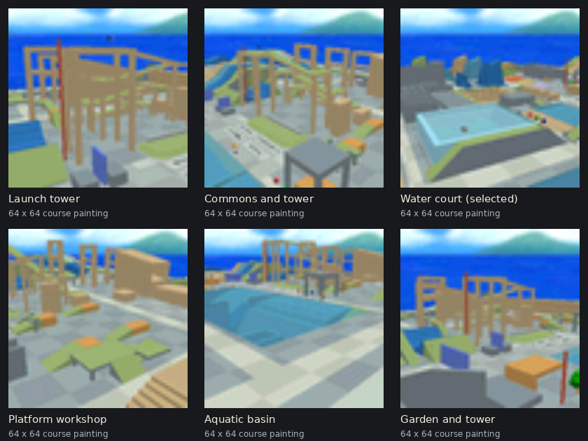

# Physics Lab course painting

Created on 2026-10-07 from 48 new in-game screenshots across 16 fixed camera
angles. The selected painting shows the water court; five alternatives show
the launch tower, commons, platform workshop, aquatic basin and garden.

## Images

- [Full-resolution painting](physics-lab-painting-full-resolution.png):
  untouched 240 × 240 square crop.
- [Original water court screenshot](physics-lab-water-court-original.png):
  untouched 320 × 240 capture.
- [Selected course painting](physics-lab-painting.rgba16.png): 64 × 64, opaque
  RGBA16-compatible pixels.
- [Filtered painting preview](painting-preview.png): enlarged for viewing.
- [Top half](physics-lab-painting-top.rgba16.png) and
  [bottom half](physics-lab-painting-bottom.rgba16.png): two 64 × 32 textures,
  matching the original castle course painting layout. Each encodes to 4 KiB.
- [Screenshot contact sheet](screenshots-contact-sheet.png): all 16 angles.
- The screenshots folder contains all 48 original 320 × 240 frame captures.
- Each named option folder contains its untouched square source crop, 64 × 64
  course texture, 128 × 128 alternative and the two native texture halves.

The painting is a square crop of the captured scene, resampled and quantized to
five bits per color channel. Its colors, geometry and background come from the
game. The original screenshots remain intact. No generated artwork, painted
additions or synthetic texture detail was used. The 64 × 64 image and two
64 × 32 halves follow the existing castle course paintings' texture dimensions.

## Capture and sources

Captured in Ares from the existing GCC 16.2 US capture ROM built on 2026-10-07.
The game's renderer produced the completed RGBA16 framebuffers. Fixed camera
positions compose the views; Mario and the HUD are hidden for photography.
World actors and animation continue to update, with three captures per angle.
Private emulator settings and saves leave ordinary play settings intact. No new
ROM was built for the photographs.

The Physics Lab's geometry and arrangement are project work. The images also
contain Nintendo's inherited skybox, character, object and effect assets, as
used by this hack. See the [asset source register](../../../docs/asset-sources.md)
for the underlying asset credits.

[Capture and crop metadata](manifest.json) records the camera positions, source
hashes, frozen ROM/ELF identity and selected crops. The capture scripts and raw
framebuffers are retained in the project's dated painting output folder.

These are prepared painting assets. Placement and warp behavior are not part
of this image capture task.
